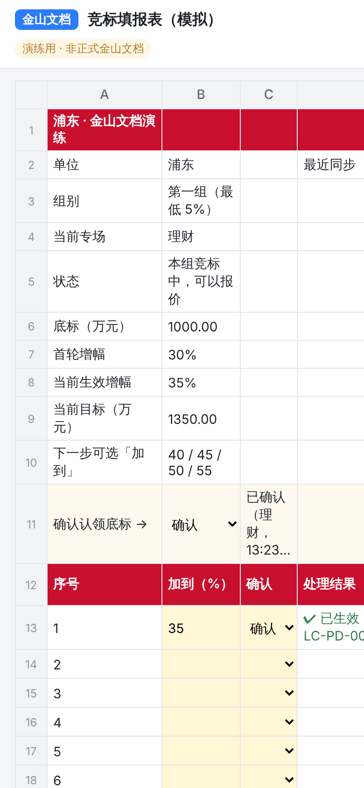

# 金山文档接入说明

领导用**微信打开金山文档**，在本单位的工作表里填写；会场电脑上的竞标程序（Windows 一键包）每隔几秒读取一次，按与手机网页**完全相同的规则**处理，大屏同步更新，处理结果写回表格。

不需要租服务器、买域名、备案，也不需要领导连会场 Wi-Fi。

```
领导微信 ──> 金山文档：本单位工作表（只读信息区 + 填写「加到多少」「确认」）
                  ▲ 写回处理结果                │ 每隔几秒读取一次（AirScript 脚本令牌）
                  │                              ▼
          会场电脑：竞标程序（规则判断 → 数据库 → 大屏 / 管理端 / 导出）
```

> **当前状态**：程序端已完成，并已用「模拟金山文档」完整测试（模拟器运行的就是同一份 AirScript 脚本）。
> 在真实金山文档上还需要做一次实测，见第七节清单。脚本接口按金山文档官方「AirScript 脚本令牌」文档实现；
> 本开发环境无法访问 kdocs.cn，未能在真实表格上运行。

## 一、先用模拟金山文档演练（不需要金山账号）

1. 启动系统，管理端新建演示活动（或正式活动并导入首轮数据）。
2. 打开活动 →「金山文档」→「使用模拟金山文档」。系统会建好 16 张单位工作表并写入版式。
3. 把「同步间隔」改为 1～3 秒 →「开启同步」。
4. 点「打开模拟表格（领导填写页）」。这个页面模拟金山文档，黄色格子可填，其余只读。
   - 想模拟某一位领导，在地址末尾加上 `&sheet=浦东`，页面就只显示浦东的工作表。
   - 手机与电脑连同一 Wi-Fi 时，把地址里的 `localhost` 换成电脑的局域网 IP，就能用手机打开。
5. 按正常流程演练：「首轮数据」发布 →「现场控制」开放第一组 → 在模拟表格里确认底标、填写「加到」→ 看大屏。

模拟表格只存在内存中，程序重启后需要重新点「使用模拟金山文档」。



## 二、表格版式（每家单位一张工作表，表名 = 单位名称）

| 位置 | 内容 | 谁填 |
| --- | --- | --- |
| A1 | 标题 | 程序 |
| B2:B10 | 单位、组别、当前专场、状态、底标、首轮增幅、**当前生效增幅**、当前目标、**下一步可选「加到」** | 程序 |
| E2 | 最近同步时间 | 程序 |
| **B11** | 认领底标：选「确认」 | **领导** |
| C11 | 认领结果 | 程序 |
| 第 12 行 | 表头：序号、加到（%）、确认、处理结果、处理时间 | — |
| **第 13 行起 B 列** | 加到多少（如 35） | **领导** |
| **第 13 行起 C 列** | 选「确认」 | **领导** |
| 第 13 行起 D、E 列 | 处理结果、处理时间 | 程序 |

工作表名称必须与单位名称完全一致：浦东、闵行、宝山、嘉定、奉贤、松江、黄浦、虹口、静安、普陀、长宁、徐汇、杨浦、青浦、金山、崇明。可以多一张「使用说明」表，程序不读它。

## 三、接入真实金山文档（工作人员，约 30 分钟）

1. **建表格**：管理端「金山文档」→ 下载「填报表模板」。在金山文档网页版（电脑浏览器）用单位账号登录，新建 → 导入本地文件，上传模板，得到在线**表格**。
2. **粘贴脚本**：在这个表格中打开 **AirScript 脚本编辑器**（菜单一般在「效率 / 开发工具」下，名称以金山文档当前界面为准）。新建一个**共享脚本**，删除默认内容，粘贴管理端下载的「同步脚本」**全文**，保存。不要修改脚本。
3. **脚本令牌**：在脚本编辑器中点「脚本令牌」，生成并复制令牌。令牌相当于运行该脚本的钥匙，请妥善保存。
4. **webhook 链接**：在脚本列表中该脚本的「…」菜单里点「复制 webhook 链接」。链接形如 `https://www.kdocs.cn/api/v3/ide/file/…/script/…/sync_task`。
5. **一键连接**：管理端「金山文档」，把 webhook 链接和脚本令牌粘贴进去（两样可以一起粘贴到链接框，程序会自动拆开），点「**一键连接**」。程序依次完成并逐项显示结果：
   - ✔ 保存链接与令牌
   - ✔ 测试连接（16 家单位工作表齐全）
   - ✔ 写入表格版式（标题、标签、表头、序号）
   - ✔ 开启同步（不想马上开启，取消勾选「连接后立即开启同步」）

   哪一步显示 ✘，后面会写明原因，对照第八节处理。
6. **设置权限**：
   - 把表格分享给 16 位领导，设为「可编辑」。
   - 为每张单位工作表设置**区域权限**：该单位领导只能编辑 **B11** 和报价区的 **B、C 两列**（B13:C52），其余单元格只读；其他单位领导不能编辑这张表。
   - 如果金山文档的区域权限不能按人设置，需要改为每家一个独立表格，告诉开发人员调整。
7. 首次开启同步时，表格里已经填写的报价行会标记为「开始同步前已填写」，不参与竞标。
8. 用 2 部手机（iPhone、安卓各一）在微信里打开表格，按第四节完整走一遍。

## 四、领导怎么填（可转发给领导）

1. 在微信中打开工作人员分享的金山文档，切换到**本单位**的工作表。
2. 专场开始后，B11 旁边会提示「请在 B11 选择『确认』」。在 B11 选「确认」，C11 显示「已确认」即可。
3. 轮到本组时，在第 13 行起的空行里：**B 列填「加到多少」**（例如 35），**C 列选「确认」**。
4. 几秒后，第 8 行「当前生效增幅」更新，D 列显示「✔ 已生效」。若显示「✘ 未生效」，后面会写明原因。
5. 再次加码请填**下一行**。每行只处理一次，处理过的行再改无效；增幅只增不减，填低了不会生效。
6. 第 10 行「下一步可选」列出现在可以填的数值。

手机屏幕较窄时，D 列「处理结果」可能需要左右滑动才能看到；以第 8 行「当前生效增幅」为准即可。

## 五、规则说明（与手机网页一致）

- **填的是「加到多少」，不是「加多少」**：网络卡顿时重复提交同一个数，只记一次；填低了不生效，不会调减。
- **每行只处理一次**：以本机程序读到该行（B 列有值且 C 列为「确认」）的时间为准。处理后再修改该行，D 列会提示「修改无效，请在下一行填写」。
- **认领底标**：每个专场（理财、基金）首轮发布后，程序先清空 B11 并提示确认，读到之后的「确认」才算认领。上一专场的「确认」不会自动用到下一专场。
- **结束本组、暂停、锁定前**，管理端会先自动读一次表格，把最后几秒的填写读进来。如果当时读取失败，操作照常执行，但会提示「最后几秒的填写可能未读入，请核对表格」。
- **底标、首轮、档位、组别、并列、标王**等判断全部由程序完成，与手机网页、管理员代录是同一套逻辑。台账导出中来源标注为「领导提交（金山文档）」。
- 手机网页扫码和金山文档可以同时使用，互不影响；工作人员「代录」「代记」也照常可用。

## 六、现场注意

- **会场电脑必须能上互联网**（访问 kdocs.cn）；大屏、管理端仍在这台电脑或会场局域网内使用。
- 「金山文档」页显示同步状态：最近成功时间、连续失败次数、缺少的工作表、最近处理的填写。
- **金山文档不可用或会场断网时**：暂停竞标，工作人员看着表格（或电话确认），用「现场控制」中的「代录」录入，恢复后同步会自动继续。
- 程序重启后自动恢复同步。未认领底标的单位，B11 会被重新清空并提示确认一次。

## 七、真实金山文档实测清单（正式使用前完成）

| # | 检查项 | 怎么做 | 通过标准 |
| --- | --- | --- | --- |
| 1 | 脚本能运行、能返回结果 | 「测试连接」 | 提示 16 家工作表齐全 |
| 2 | 能写回 | 「初始化表格版式」 | 各表出现标题、标签、表头、序号 |
| 3 | 读取速度与限流 | 开启同步（间隔 3 秒），放置 1 小时以上 | 「调用次数」持续增加，「失败」接近 0；单次耗时记入验收记录 |
| 4 | 区域权限 | 用领导账号尝试修改信息区、其他单位的表 | 不能修改 |
| 5 | 微信打开体验 | iPhone、安卓各一台，关闭 Wi-Fi，在微信中打开表格并完整填写 | 能选择「确认」、能填数字，结果几秒内出现 |
| 6 | 多人同时填写 | 3 位以上同时在各自工作表填写 | 全部正确处理，无串表 |
| 7 | 令牌有效期 | 隔天再「测试连接」 | 仍然可用（如会过期，会前一天重新生成并填入） |

若第 1 项提示「脚本没有返回结果」，说明当前金山文档版本取返回值的方式与文档不同。请把提示原文和脚本编辑器中的运行日志截图发给开发人员。

## 八、常见提示

| 提示 | 原因与处理 |
| --- | --- |
| 脚本令牌无效、已过期或无权运行该脚本 | 重新生成令牌，在管理端填入（只填令牌，链接不变） |
| 脚本没有返回结果 / 脚本版本与本程序不匹配 | 从管理端重新下载脚本，在编辑器中**整体替换**后保存 |
| 缺少工作表：×× | 工作表名称与单位名称不一致，或被删除；改名后「初始化表格版式」 |
| 调用过于频繁，金山文档暂时限流 | 把同步间隔调大（如 5 秒） |
| 无法连接金山文档 | 检查会场电脑的互联网连接 |
| 清空填写区前请先停止同步 | 防止现场误删；演练结束后先「停止同步」再清空 |

## 九、以后的活动、反复演练

- 金山表格、脚本、令牌**只需准备一次**。新建活动后进「金山文档」页，点「**沿用这张表格，一键连接**」即可（自动使用上一次的链接和令牌）。
- 同一张表格同一时间只能由一个活动同步：新活动开启同步时，旧活动对这张表格的同步会自动停止，并在页面上提示。
- **新建一个演示活动**，沿用同一张表格并开启同步。表格里已有的报价行会自动标记为「开始同步前已填写」，不影响新活动。
- 想让表格干净：先「停止同步」，再点「清空表格填写区」（清空 16 张表的 B11 和报价区 B–E 列）。

## 十、安全

- 脚本令牌保存在本机数据库中，页面上只显示末 4 位；数据库备份文件中也包含令牌，请妥善保管备份。
- 令牌泄露时，在脚本编辑器中重新生成，旧令牌即失效。
- 程序只接受 `kdocs.cn` 的脚本链接（以及本机模拟地址），不会向其他网站发送令牌。
- 表格里只有各单位的底标、增幅与金额，没有个人信息；是否允许把这些数据放在金山文档，请与单位信息科技部门确认。
